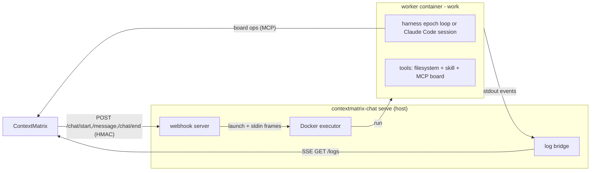

# ContextMatrix Chat

> [!WARNING]
>
> This project is under heavy development. Breaking changes should be expected
> at the current stage.

`contextmatrix-chat` is the **chat backend** for ContextMatrix: a Go service
that runs interactive AI chat sessions in isolated Docker containers, bridges
the board's MCP tools into each session, and streams the conversation back to
ContextMatrix over Server-Sent Events. It reuses the shared
[`contextmatrix-harness`](https://github.com/mhersson/contextmatrix-harness) for
the interactive loop - in-context compaction, seeded-history resume, and live
turns. A chat on a Claude Code subscription runs on a Claude Code session
instead (see [Claude Code subscription mode](#claude-code-subscription-mode)).
It targets operators running ContextMatrix who want model-flexible,
board-aware chat.

## How it fits ContextMatrix

ContextMatrix splits its execution backends:

- **TaskBackend** - card execution (`contextmatrix-agent`).
- **ChatBackend** - interactive chat sessions (this service).

The chat backend is selected and configured operator-side and runs alongside
the task backend. It talks to ContextMatrix over these channels:

- **Chat lifecycle webhooks** (CM → chat) - HMAC-signed `POST /chat/start`,
  `POST /message`, `POST /chat/end`.
- **Log stream** (chat → CM) - Server-Sent Events at `GET /logs?session_id=…`.
- **Board operations** (worker → CM, over **MCP**) - the in-session model reads
  and writes cards, starts autonomous card runs, and hands a need over to the
  architect, through ContextMatrix's MCP endpoint.
- **Git credentials** (worker → CM) - `GET /api/worker/git-credentials` with
  the session's bearer mints a token for one repository on each git or gh call.
- **Task-skills source** (chat → CM) - `GET /api/chat/task-skills-source`
  returns the `{git_remote_url, ref}` pointer serve clones and mounts into
  each worker.
- **Image inventory** (CM → chat) - HMAC-signed `GET /images` backing
  ContextMatrix's worker-image settings dropdown.
- **Health** (CM → chat) - open `GET /health` returns `ok`,
  `running_containers`, `max_concurrent`, `build` (`version`: the exact tag,
  left out when HEAD was on none; `commit` and `build_time`, left out of an
  unstamped build; `changes`: the last 20 merged PRs, newest first, without
  Dependabot and ci/docs/chore/build/test/refactor/style PRs)
  and `worker_image_revision` (the `org.opencontainers.image.revision` label of
  `base_image`, left out when the image or label cannot be read).
  ContextMatrix shows them in its About popup.

The model is chosen per session by ContextMatrix, and ContextMatrix's
instance-wide MCP API key rides along; both arrive in the chat-start payload -
the chat backend does not select models.

## Architecture



`serve` owns the container lifecycle: it hosts the lifecycle webhooks, launches
one worker per session, applies resource caps, writes per-session resume state
and the host-side task-skills clone, fans container logs to SSE subscribers,
and drains on `SIGTERM` (stop accepting work, shut down HTTP, kill tracked
containers). `work` runs the inner loop inside the container: it assembles the
tool registry (filesystem/shell tools rooted at `/workspace`, an optional skill
tool, and the board's MCP tools), seeds history when resuming, and drives the
interactive epoch loop. The loop, LLM client, tools, redaction, and event
stream live in the standalone `contextmatrix-harness` module - FSM-free and
free of any `contextmatrix-*` dependency. A Claude Code subscription chat
drives a Claude Code session loop instead: one `claude` process per session,
run by the `contextmatrix-vendorkit` module.

## Requirements

- Go 1.27+ to build.
- Docker on the host running `serve` (it launches worker containers). On
  Linux, `serve` must run as host UID 1000 (see below).
- A reachable ContextMatrix instance (REST API + MCP endpoint). ContextMatrix
  provisions the per-session model, LLM endpoint, and git credentials, plus its
  instance-wide MCP API key, in the chat-start payload - git credentials are then fetched
  fresh per repo, per operation, from CM's worker git-credentials endpoint,
  not staged upfront. There is no local credential fallback.
- Upstream LLM calls leave from `serve`, so its own `HTTP(S)_PROXY` / `NO_PROXY` environment governs them; an egress proxy set only in `worker_extra_env` no longer reaches LLM traffic, so give serve's process (e.g. its service unit) the proxy env.
  In Claude Code subscription mode `claude` reaches Anthropic from the worker instead, so the `worker_extra_env` proxy settings and `ca_cert_file` apply to it.
  There `NO_PROXY` must also include `127.0.0.1,localhost` and the host of `container_contextmatrix_url`: Node does not skip loopback, so a proxy without them breaks the loopback MCP bridge, CM's MCP and the git-credentials fetch. `HTTP_PROXY` alone carries `claude`'s https API traffic; use `HTTPS_PROXY` for it, or add `.anthropic.com` to `NO_PROXY` when the proxy is not meant to carry it.
- Workers must reach serve's webhook port at `container_serve_url` (by default `host.docker.internal:<port>`, the Docker host gateway); a host firewall must allow it.
- A shared HMAC secret (at least 32 characters), configured on both this service
  and ContextMatrix.

### Host UID 1000

Worker containers run as container UID 1000. `serve` creates each session's
run directory with mode 0750 under `chat_run_dir`, writes `resume.jsonl` into
it, and bind-mounts it read-only at `/run/cm-chat`; it also bind-mounts
`ca_cert_file` when configured. Session secrets (the MCP key, the git-credentials
bearer, and the LLM proxy token below) reach the worker as container environment,
not files; a Claude Code subscription token does too (see below), and the model's
shell, running as the same user, can read all of them from `/proc`. When `serve` runs as another host UID or GID, or under
rootless Docker (where container UID 1000 maps to a subuid), the worker cannot
read the run directory. A resumed chat then logs "starting fresh" and silently
loses its prior conversation, and a `ca_cert_file` the worker cannot read fails
the session at startup. Fresh sessions otherwise run. `serve` logs a warning
on Linux when its UID is not 1000.

## Worker credentials

The real LLM key never enters a worker container. `serve` registers the
session's LLM endpoint with an in-process proxy and gives the worker a
stand-in token plus the proxy URL.

```
 CM ──trigger (real key)──▶ serve (host)
                            ┌──────────────────────────────┐
                            │ keeps REAL KEY in memory     │
                            │ proxy: token T → REAL KEY    │
                            └──▲─────────────────┬─────────┘
            gives the container│only token T     │ Authorization: REAL KEY
            + proxy URL        │                 ▼
                  ┌────────────┼── worker ─┐   LLM gateway / OpenRouter
                  │ LLM_API_KEY = T (stand-in)
                  │ LLM_BASE_URL = http://host.docker.internal:<port>/llm
                  │ worker ──Authorization: T──▶ proxy on serve
                  │ bad dependency: reads T   │
                  └───────────┬───────────────┘
                              │ sends T out
                              ▼
            T at the gateway   → rejected (the gateway has never seen T)
            T at serve's proxy → reachable only inside the trusted network,
                                 and dead once the run ends
```

- At chat/start the endpoint is registered under the session ID and the worker
  gets `LLM_API_KEY=<token>` and `LLM_BASE_URL=<container_serve_url>/llm`.
- `serve` swaps the token for the real key on each upstream call, and revokes
  the token when the container exits or the launch fails.
- A resumed session gets a fresh token; the old one stays dead.

Exception: a Claude Code subscription session (`claude_code` endpoint) bypasses
the proxy. serve puts the subscription token in the worker env as
`LLM_OAUTH_TOKEN` (with `LLM_TYPE=claude_code`), where a prompt-injected session
could read and exfiltrate it; serve still masks it in every bridged frame.
The worker unsets it from its own environment, but it stays readable in the
container (see Claude Code subscription mode). `worker_extra_env` can never set `LLM_OAUTH_TOKEN` or an `LLM_TYPE` of
`claude_code`, and in a Claude Code session it cannot set `LLM_TYPE`,
`LLM_API_KEY` or `LLM_BASE_URL` either; serve logs the withheld names once.

Limits:

- Overriding the key in `worker_extra_env` needs `LLM_BASE_URL` as well; the pair bypasses the proxy and puts that key in the container.
- An HTTP proxy set in `worker_extra_env` needs the serve host (`host.docker.internal` by default) in `NO_PROXY`.

## Claude Code subscription mode

When ContextMatrix runs a chat on a Claude Code subscription, the chat-start
payload carries an LLM endpoint of type `claude_code` with the subscription
token (`claude setup-token`) instead of an endpoint URL and key, next to the
usual model and MCP key. serve skips the LLM proxy and passes the token to the
worker as `LLM_OAUTH_TOKEN` with `LLM_TYPE=claude_code`. The worker reads the
token once, unsets it from its own environment, and passes it only to
`claude`'s environment (`CLAUDE_CODE_OAUTH_TOKEN`).

The token is still readable inside the container: it remains in
`/proc/1/environ` (the worker's initial environment, which unsetting does not
rewrite) and in the worker's and `claude`'s environ, all the same user as the
model's Bash. This is an accepted risk; no hardening is applied.

- **Version check.** At boot the worker runs `claude --version`. When the
  worker image (or the project's chat worker image) has no runnable `claude`,
  the chat pane shows an error naming the tested release and the worker exits;
  it never falls back to the endpoint. A different version logs one warning
  naming both versions, and the chat runs.
- **One `claude` process per session**, working in `/workspace` with the worker
  user's HOME, so the git credential helper, the `gh` wrapper and the
  toolchains work in its Bash as they do in harness mode. Its tools come from
  Claude Code's built-ins (Read, Write, Edit, Bash); grep, glob, git and the
  task-skills tool, which the worker serves over a loopback MCP server; and the
  board tools from ContextMatrix's own MCP server, which `claude` connects to
  as `contextmatrix`. The worker fails at boot when no MCP URL is provisioned.
- **Resume and `/clear`.** A resumed chat opens with the restored transcript,
  rendered as text above the orientation primer. `/clear` ends the `claude`
  process and starts a fresh one, opened by the primer.
- **Turns.** A message sent while `claude` is working waits for the turn to
  end; everything that arrived in the meantime goes as the next turn.
- **Failures.** A `claude` process that exits is resumed on the next message,
  and a message the exited process never took is sent once more to the resumed
  one; if that resume cannot start, a fresh session opens with the primer.
  Nothing restarts on its own before that message. A failed turn shows one
  error line. A subscription usage limit shows
  in the chat pane, never falls back to the LLM endpoint, and lifts on the
  first message after the reset. A token Claude Code rejects ends the chat
  with an error.
- **Transcripts.** Resume within a session reads the conversation transcripts
  kept under the container's HOME (`~/.vendorkit/sessions`). The worker never
  prunes them; they go when the container is removed at session end.
- **What does not apply:** compaction (Claude Code compacts on its own),
  reasoning replay, `tool_output_max_bytes`, and redacting tool output before
  the model sees it (the events stay redacted). `reasoning_effort` becomes
  Claude Code's effort, and a value it does not accept falls back to its
  default. `bash_timeout_max_seconds` does apply, as the ceiling of Claude
  Code's Bash timeout.

The token owner must be the only human who drives chat sessions on it, even
when ContextMatrix has several accounts; nothing enforces this, so it is an
operator obligation. The token is readable inside the worker, so a
prompt-injected session could exfiltrate it (see
[Worker credentials](#worker-credentials)).

## Running as a ContextMatrix backend

1. **Build the worker image.**

   ```bash
   make docker-worker           # tags contextmatrix-chat-worker:dev (full)
   make docker-worker-variants  # go-node / python / rust / jvm-node variants
   ```

   The default (`full`) image carries the baseline CLIs (`git`, `gh`, `rg`,
   `fd`, `shellcheck`, `shfmt`, `kubectl`, `kustomize`, `yq`, `task`, `zip`,
   `unzip`, `node`) plus the **Go, Python, and Rust** toolchains - Go with
   `golangci-lint`/`gofumpt`, Python via `uv`/`uvx` (a managed CPython) with
   `ty`/`ruff`, and Rust via `rustup`/`cargo` with `clippy`/`rustfmt`. Slimmer single-language variants
   (`go-node`, `python`, `rust`) are also published, along with `jvm-node` for
   Kotlin/Java + Node projects (JDK 21 as `java`, Maven, Node 24, `yarn`; not
   part of `full`). Every variant also carries the pinned `claude` binary
   (`/usr/local/bin/claude`, from Claude Code's npm platform tarball, with no
   Node needed), which Claude Code subscription chats run on; a project's own
   worker image used for such a chat must carry a runnable `claude` too, or the
   boot version check fails the chat (see
   [Claude Code subscription mode](#claude-code-subscription-mode)). Debian
   packages come from Debian's signed repositories; the
   downloaded Go, Node, rustup, Maven, gh, yq, Task and `claude` archives and
   binaries are pinned and SHA-verified; the uv image is digest-pinned; golangci-lint and
   gofumpt are built from source at pinned versions; npm, yarn, pip, ty and
   ruff are pinned by version and fetched from their registries.

   Any other ecosystem (Ruby, .NET) **needs an image carrying that
   toolchain** - build one `FROM` a published variant (see the agent repo's
   [`docs/custom-images.md`](https://github.com/mhersson/contextmatrix-agent/blob/main/docs/custom-images.md)
   pattern) and point a project at it via the chat worker image in
   ContextMatrix's project settings.

   For a real deployment, publish a digest-pinned image and reference it from
   `base_image`.

   Every image these targets build carries the label
   `org.opencontainers.image.revision`, set to the commit it was built from.
   Serve reports that label for `base_image` on `/health`, so ContextMatrix
   can show when the worker image was built from a different commit than
   serve.

2. **Write the service config.**

   ```bash
   mkdir -p ~/.config/contextmatrix-chat
   cp serve.yaml.example ~/.config/contextmatrix-chat/serve.yaml
   # set: contextmatrix_url, container_contextmatrix_url, api_key,
   #      base_image, chat_run_dir
   ```

   ContextMatrix provisions git credentials and the LLM endpoint per session;
   the chat service carries no local credential config.

   Every scalar field also has a `CMX_*` override (see
   [Configuration](#configuration)).
   `container_contextmatrix_url` is the ContextMatrix URL as seen from inside
   containers - without it, workers point at their own localhost and fail at MCP
   connect. For a Docker bridge network this is typically
   `http://172.17.0.1:8080`.

3. **Run the service.**

   ```bash
   ./contextmatrix-chat serve            # listens on :9093
   ```

   It reads `--config` (default `~/.config/contextmatrix-chat/serve.yaml`) and
   validates the merged config at startup.

4. **Point ContextMatrix at it.** Configure ContextMatrix's chat backend to send
   lifecycle webhooks to this service's URL, signing them with the shared
   `api_key`. The ContextMatrix-side configuration lives in the ContextMatrix
   repo.

### Service management

For an unattended deployment, run chat as a systemd **user** service instead of
the foreground `serve` command:

```bash
make build                    # build the contextmatrix-chat binary
./svc.sh install              # write + enable ~/.config/systemd/user/contextmatrix-chat.service
./svc.sh start                # start it (also: stop / status / print / verify / uninstall)
```

The generated unit is sandboxed (read-only home, restricted syscalls, resource
caps) and runs `serve --config ${XDG_CONFIG_HOME:-~/.config}/contextmatrix-chat/serve.yaml`.
`svc.sh` reads `chat_run_dir` from that config and whitelists it for writing.

`redeploy.sh` updates a running install in place - rebuild the binary and all
worker images (full + variants), pin the new full-image digest into
`serve.yaml`, and restart the service:

```bash
./redeploy.sh
```

> **Writable runtime dirs.** Chat writes its task-skills clone cache under
> `secrets_dir` (default `/var/run/cm-chat/secrets`) and per-session state under
> `chat_run_dir`.
> `/var/run` is root-owned and not created for a user service - either pre-create
> `/var/run/cm-chat` and `chown` it to your user, or set these to paths under your
> home (e.g. `~/.cm-chat/secrets`, `~/.cm-chat/runs`); the unit whitelists both
> trees plus the configured `chat_run_dir`.

## Commands

| Command                                   | Purpose                                                                              |
| ------------------------------------------ | ------------------------------------------------------------------------------------ |
| `serve`                                   | Run the chat backend: host ContextMatrix chat sessions and launch worker containers. |
| `work`                                    | Container entrypoint (hidden): run one interactive chat session.                     |
| `contextmatrix-chat config defaults`      | Print the complete default service config as YAML (schema for contextmatrix-setup)   |
| `contextmatrix-chat config validate FILE` | Load `FILE` as `serve` would; exit 1 on the first error                              |

## Configuration

Configuration is layered: defaults < config file < environment. The file
defaults to `~/.config/contextmatrix-chat/serve.yaml` (the XDG config path).
Every scalar field has a `CMX_*` environment override; nested keys use a double
underscore (`CMX_COMPACTION__THRESHOLD`, `CMX_COMPACTION__KEEP_RECENT_TURNS`).
`image_list_filters` and `worker_extra_env` are YAML-only - the `CMX_` layer
cannot express multi-element lists or case-sensitive map keys.
`serve.yaml.example` documents every field, its default, and its env override.
Unknown keys in the config file are an error that names them (shown by
`contextmatrix-chat config validate FILE`); the `CMX_*` env layer stays
lenient.

Required fields: `contextmatrix_url`, `api_key` (≥ 32 chars), `base_image`,
`chat_run_dir`. Credentials are not configured here: ContextMatrix provisions
the LLM endpoint and git credentials per session; the service fails a
chat-start closed when either is missing from the payload.

Task-skills need no chat config: serve fetches a git pointer from ContextMatrix,
clones it on the host, and mounts it read-only into each worker at
`/run/cm-skills`. CM is the single source of truth.

## Development

```bash
make build          # go build ./... + the stamped binary
make install        # go install the stamped binary
make test           # go test ./...
make test-race      # CGO_ENABLED=1 go test -race ./...
make lint           # golangci-lint run
make fmt            # gofumpt -w ./cmd ./internal
make docker-worker  # build the worker image
```

`make build` and `make install` stamp the tag (when HEAD is exactly on one),
the commit, the build time and the last 100 first-parent merges into the
binary. A build without git history (a source tarball, a shallow clone)
reports an empty change list.

CI gates on `go test`, `go test -race`, `golangci-lint`, `go build`,
`govulncheck`, a Dockerfile `hadolint` pass, and a Trivy scan of the worker
image. Conventions, package boundaries, and commit discipline live in
[AGENTS.md](AGENTS.md).

## Further reading

- [AGENTS.md](AGENTS.md) - orientation for contributors and agents.
- [serve.yaml.example](serve.yaml.example) - every service config field,
  documented.
- [ContextMatrix](https://github.com/mhersson/contextmatrix) - the control plane.

## License

MIT - see [LICENSE](LICENSE).
