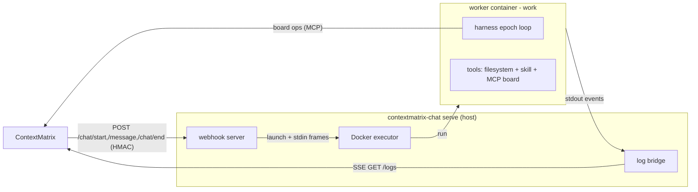

# ContextMatrix Chat

> [!WARNING]
>
> This project is under heavy development. Breaking changes should be expected
> at the current stage.

`contextmatrix-chat` is the **chat backend** for ContextMatrix: a Go service
that runs interactive AI chat sessions in isolated Docker containers, bridges
the board's MCP tools into each session, and streams the conversation back to
ContextMatrix over Server-Sent Events. It reuses the shared
[`contextmatrix-harness`](https://github.com/mhersson/contextmatrix-harness) for
the interactive loop - in-context compaction, seeded-history resume, and live
turns. It targets operators running ContextMatrix who want model-flexible,
board-aware chat.

## How it fits ContextMatrix

ContextMatrix splits its execution backends:

- **TaskBackend** - card execution (`contextmatrix-agent`).
- **ChatBackend** - interactive chat sessions (this service).

The chat backend is selected and configured operator-side and runs alongside
the task backend. It talks to ContextMatrix over five channels:

- **Chat lifecycle webhooks** (CM → chat) - HMAC-signed `POST /chat/start`,
  `POST /message`, `POST /chat/end`.
- **Log stream** (chat → CM) - Server-Sent Events at `GET /logs?session_id=…`.
- **Board operations** (worker → CM, over **MCP**) - the in-session model reads
  and writes cards, starts autonomous card runs, and hands a need over to the
  architect, through ContextMatrix's MCP endpoint.
- **Image inventory** (CM → chat) - HMAC-signed `GET /images` backing
  ContextMatrix's worker-image settings dropdown.
- **Health** (CM → chat) - open `GET /health` returns `ok`,
  `running_containers`, `max_concurrent`, `build` (`version`: the exact tag,
  left out when HEAD was on none; `commit` and `build_time`, left out of an
  unstamped build; `changes`: the last 20 merged PRs, newest first, without
  Dependabot and ci/docs/chore/build/test/refactor/style PRs)
  and `worker_image_revision` (the `org.opencontainers.image.revision` label of
  `base_image`, left out when the image or label cannot be read).
  ContextMatrix shows them in its About popup.

The model is chosen per session by ContextMatrix, and ContextMatrix's
instance-wide MCP API key rides along; both arrive in the chat-start payload -
the chat backend does not select models.

## Architecture



`serve` owns the container lifecycle: it hosts the lifecycle webhooks, launches
one worker per session, applies resource caps, writes per-session resume state
and the host-side task-skills clone, fans container logs to SSE subscribers,
and drains on `SIGTERM` (stop accepting work, shut down HTTP, kill tracked
containers). `work` runs the inner loop inside the container: it assembles the
tool registry (filesystem/shell tools rooted at `/workspace`, an optional skill
tool, and the board's MCP tools), seeds history when resuming, and drives the
interactive epoch loop. The loop, LLM client, tools, redaction, and event
stream live in the standalone `contextmatrix-harness` module - FSM-free and
free of any `contextmatrix-*` dependency.

## Requirements

- Go 1.27+ to build.
- Docker on the host running `serve` (it launches worker containers). On
  Linux, `serve` must run as host UID 1000 (see below).
- A reachable ContextMatrix instance (REST API + MCP endpoint). ContextMatrix
  provisions the per-session model, LLM endpoint, and git credentials, plus its
  instance-wide MCP API key, in the chat-start payload - git credentials are then fetched
  fresh per repo, per operation, from CM's worker git-credentials endpoint,
  not staged upfront. There is no local credential fallback.
- A shared HMAC secret (at least 32 characters), configured on both this service
  and ContextMatrix.

### Host UID 1000

Worker containers run as container UID 1000. `serve` creates each session's
run directory with mode 0750 under `chat_run_dir`, writes `resume.jsonl` into
it, and bind-mounts it read-only at `/run/cm-chat`; it also bind-mounts
`ca_cert_file` when configured. Session secrets reach the worker as container
environment, not files. When `serve` runs as another host UID or GID, or under
rootless Docker (where container UID 1000 maps to a subuid), the worker cannot
read the run directory. A resumed chat then logs "starting fresh" and silently
loses its prior conversation, and a `ca_cert_file` the worker cannot read fails
the session at startup. Fresh sessions otherwise run. `serve` logs a warning
on Linux when its UID is not 1000.

## Running as a ContextMatrix backend

1. **Build the worker image.**

   ```bash
   make docker-worker           # tags contextmatrix-chat-worker:dev (full)
   make docker-worker-variants  # go-node / python / rust / jvm-node variants
   ```

   The default (`full`) image carries the baseline CLIs (`git`, `gh`, `rg`,
   `fd`, `shellcheck`, `shfmt`, `kubectl`, `kustomize`, `yq`, `task`, `zip`,
   `unzip`, `node`) plus the **Go, Python, and Rust** toolchains - Go with
   `golangci-lint`/`gofumpt`, Python via `uv`/`uvx` (a managed CPython) with
   `ty`/`ruff`, and Rust via `rustup`/`cargo` with `clippy`/`rustfmt`. Slimmer single-language variants
   (`go-node`, `python`, `rust`) are also published, along with `jvm-node` for
   Kotlin/Java + Node projects (JDK 21 as `java`, Maven, Node 24, `yarn`; not
   part of `full`). Toolchain versions are pinned and checksum-verified.

   Any other ecosystem (Ruby, .NET) **needs an image carrying that
   toolchain** - build one `FROM` a published variant (see the agent repo's
   [`docs/custom-images.md`](https://github.com/mhersson/contextmatrix-agent/blob/main/docs/custom-images.md)
   pattern) and point a project at it via the chat worker image in
   ContextMatrix's project settings.

   For a real deployment, publish a digest-pinned image and reference it from
   `base_image`.

   Every image these targets build carries the label
   `org.opencontainers.image.revision`, set to the commit it was built from.
   Serve reports that label for `base_image` on `/health`, so ContextMatrix
   can show when the worker image was built from a different commit than
   serve.

2. **Write the service config.**

   ```bash
   mkdir -p ~/.config/contextmatrix-chat
   cp serve.yaml.example ~/.config/contextmatrix-chat/serve.yaml
   # set: contextmatrix_url, container_contextmatrix_url, api_key,
   #      base_image, chat_run_dir
   ```

   ContextMatrix provisions git credentials and the LLM endpoint per session;
   the chat service carries no local credential config.

   Every scalar field also has a `CMX_*` override (see
   [Configuration](#configuration)).
   `container_contextmatrix_url` is the ContextMatrix URL as seen from inside
   containers - without it, workers point at their own localhost and fail at MCP
   connect. For a Docker bridge network this is typically
   `http://172.17.0.1:8080`.

3. **Run the service.**

   ```bash
   ./contextmatrix-chat serve            # listens on :9093
   ```

   It reads `--config` (default `~/.config/contextmatrix-chat/serve.yaml`) and
   validates the merged config at startup.

4. **Point ContextMatrix at it.** Configure ContextMatrix's chat backend to send
   lifecycle webhooks to this service's URL, signing them with the shared
   `api_key`. The ContextMatrix-side configuration lives in the ContextMatrix
   repo.

### Service management

For an unattended deployment, run chat as a systemd **user** service instead of
the foreground `serve` command:

```bash
make build                    # build the contextmatrix-chat binary
./svc.sh install              # write + enable ~/.config/systemd/user/contextmatrix-chat.service
./svc.sh start                # start it (also: stop / status / print / verify / uninstall)
```

The generated unit is sandboxed (read-only home, restricted syscalls, resource
caps) and runs `serve --config ${XDG_CONFIG_HOME:-~/.config}/contextmatrix-chat/serve.yaml`.
`svc.sh` reads `chat_run_dir` from that config and whitelists it for writing.

`redeploy.sh` updates a running install in place - rebuild the binary and all
worker images (full + variants), pin the new full-image digest into
`serve.yaml`, and restart the service:

```bash
./redeploy.sh
```

> **Writable runtime dirs.** Chat writes its task-skills clone cache under
> `secrets_dir` (default `/var/run/cm-chat/secrets`) and per-session state under
> `chat_run_dir`.
> `/var/run` is root-owned and not created for a user service - either pre-create
> `/var/run/cm-chat` and `chown` it to your user, or set these to paths under your
> home (e.g. `~/.cm-chat/secrets`, `~/.cm-chat/runs`); the unit whitelists both
> trees plus the configured `chat_run_dir`.

## Commands

| Command                                   | Purpose                                                                              |
| ------------------------------------------ | ------------------------------------------------------------------------------------ |
| `serve`                                   | Run the chat backend: host ContextMatrix chat sessions and launch worker containers. |
| `work`                                    | Container entrypoint (hidden): run one interactive chat session.                     |
| `contextmatrix-chat config defaults`      | Print the complete default service config as YAML (schema for contextmatrix-setup)   |
| `contextmatrix-chat config validate FILE` | Load `FILE` as `serve` would; exit 1 on the first error                              |

## Configuration

Configuration is layered: defaults < config file < environment. The file
defaults to `~/.config/contextmatrix-chat/serve.yaml` (the XDG config path).
Every scalar field has a `CMX_*` environment override; nested keys use a double
underscore (`CMX_COMPACTION__THRESHOLD`, `CMX_COMPACTION__KEEP_RECENT_TURNS`).
`image_list_filters` and `worker_extra_env` are YAML-only - the `CMX_` layer
cannot express multi-element lists or case-sensitive map keys.
`serve.yaml.example` documents every field, its default, and its env override.
Unknown keys in the config file are an error that names them (shown by
`contextmatrix-chat config validate FILE`); the `CMX_*` env layer stays
lenient.

Required fields: `contextmatrix_url`, `api_key` (≥ 32 chars), `base_image`,
`chat_run_dir`. Credentials are not configured here: ContextMatrix provisions
the LLM endpoint and git credentials per session; the service fails a
chat-start closed when either is missing from the payload.

Task-skills need no chat config: serve fetches a git pointer from ContextMatrix,
clones it on the host, and mounts it read-only into each worker at
`/run/cm-skills`. CM is the single source of truth.

## Development

```bash
make build          # go build ./... + the stamped binary
make install        # go install the stamped binary
make test           # go test ./...
make test-race      # CGO_ENABLED=1 go test -race ./...
make lint           # golangci-lint run
make fmt            # gofumpt -w .
make docker-worker  # build the worker image
```

`make build` and `make install` stamp the tag (when HEAD is exactly on one),
the commit, the build time and the last 100 first-parent merges into the
binary. A build without git history (a source tarball, a shallow clone)
reports an empty change list.

CI gates on `go test`, `go test -race`, `golangci-lint`, `go build`,
`govulncheck`, a Dockerfile `hadolint` pass, and a Trivy scan of the worker
image. Conventions, package boundaries, and commit discipline live in
[AGENTS.md](AGENTS.md).

## Further reading

- [AGENTS.md](AGENTS.md) - orientation for contributors and agents.
- [serve.yaml.example](serve.yaml.example) - every service config field,
  documented.
- [ContextMatrix](https://github.com/mhersson/contextmatrix) - the control plane.

## License

MIT - see [LICENSE](LICENSE).
